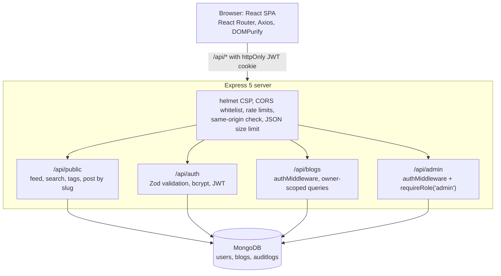

# Blogify

[](https://github.com/k-ishan-9/online-blog-platform/actions/workflows/ci.yml)

Blogify is a multi-author publishing platform built on the MERN stack. Writers draft in a rich-text editor that auto-saves, publish to a public feed with full-text search, and track their views. Admins get analytics, moderation and an audit trail. Security is layered: validated input, sanitized HTML, JWT in httpOnly cookies, ownership-scoped queries, roles, rate limits and a Content-Security-Policy. The API is covered by 30 automated tests that run in CI against a real MongoDB.

**Author:** Kishan Achanta ([GitHub](https://github.com/k-ishan-9))

---

## Features

**Readers (no account needed)**
- Public feed of published posts, newest first, with "Load more" (cursor pagination)
- Full-text search across titles, tags and content (weighted MongoDB text index), debounced as you type
- Tag filters with live counts, shareable URLs (`/?q=react&tag=webdev`, `/post/<slug>`)
- Post pages with author name, reading time and a view counter. Author emails are never exposed.

**Writers**
- Rich-text editor (React-Quill) with live word count and reading time
- Auto-save for drafts: 5 seconds after you stop typing, plus a 30-second safety net
- Publish, update a live post, or unpublish. Each post keeps one stable URL.
- Dashboard with drafts, published posts and total views

**Admins**
- Analytics: users, posts, views, posts this week, top authors (MongoDB aggregation pipelines)
- Moderation: view and delete any post
- Audit log: failed logins, signups, first publishes, admin deletions and role changes

**Engineering**
- 30 API tests (Node test runner + Supertest) against a real MongoDB, run on every push by GitHub Actions
- Docker: multi-stage image plus `docker compose` with MongoDB
- Code-split frontend: the editor and admin bundles load only when needed

---

## Architecture



---

## Security

| Threat | Defence | Where |
| --- | --- | --- |
| Stolen passwords | bcrypt (cost 10, per-user salt), 8–72 character rule | `routes/auth.js`, `validation/schemas.js` |
| Token theft by XSS | JWT in an httpOnly, SameSite=Lax cookie (Secure in production) | `config/settings.js` |
| Stored XSS | Server-side HTML allowlist (sanitize-html), DOMPurify in the browser, Content-Security-Policy | `utils/content.js`, `PostPage.jsx`, `app.js` |
| Accessing others' data (IDOR) | Every author query filters on `author: req.user.id`; others' posts return 404 | `routes/blogs.js` |
| Privilege escalation | `requireRole('admin')` on the whole admin router; promotion only via CLI | `routes/admin.js`, `scripts/makeAdmin.js` |
| Brute-force login | Rate limit: 10 failed attempts / 15 min / IP; failures logged | `app.js`, `utils/audit.js` |
| User enumeration | Same message and same timing for "no such email" and "wrong password" | `routes/auth.js` |
| NoSQL injection | Zod rejects non-string fields, for example `{"$ne": null}` | `middleware/validate.js` |
| CSRF | SameSite=Lax cookie + Origin check on state-changing requests | `middleware/sameOrigin.js` |
| Lost updates | Optimistic concurrency (`VersionError` → 409) | `models/Blog.js` |

---

## Getting Started

### Prerequisites

- [Node.js](https://nodejs.org/) 20 or newer
- MongoDB: a local server (`mongodb://127.0.0.1:27017/blogify`) or a free [MongoDB Atlas](https://www.mongodb.com/atlas) cluster

### Run it

```bash
git clone https://github.com/k-ishan-9/online-blog-platform.git
cd online-blog-platform/blogger
cp .env.example .env      # then edit MONGO_URI and JWT_SECRET
npm run build             # installs packages and builds the React app
npm start                 # http://localhost:5000
```

**Development with hot reload (two terminals):** `npm run dev` in `blogger/`, and `npm run dev` in `blogger/frontend/`. Then open http://localhost:5173. Vite proxies `/api` to port 5000.

**Docker:** `docker compose up --build`, then open http://localhost:5000. This starts MongoDB too.

**Windows one-click:** double-click `start-blogify.bat` if it is present in `blogger/`.

### Make an admin

Sign up in the app, then run `npm run make-admin -- you@example.com` and log in again.

### Run the tests

```bash
npm test   # needs MongoDB; uses MONGO_URI_TEST, default mongodb://127.0.0.1:27017/blogify_test
```

The suite refuses to run against a database whose name doesn't end in `_test`, so it can't wipe real data.

---

## API overview

| Area | Endpoints |
| --- | --- |
| Health | `GET /api/health` |
| Auth | `POST /api/auth/signup`, `POST /api/auth/login`, `GET /api/auth/me`, `POST /api/auth/logout` |
| Public | `GET /api/public/blogs?q=&tag=&cursor=&limit=`, `GET /api/public/blogs/:slug`, `GET /api/public/tags` |
| Author | `GET /api/blogs`, `GET /api/blogs/stats`, `POST /api/blogs/save-draft`, `POST /api/blogs/publish`, `GET /api/blogs/:id`, `DELETE /api/blogs/:id` |
| Admin | `GET /api/admin/blogs`, `DELETE /api/admin/blogs/:id`, `GET /api/admin/stats`, `GET /api/admin/audit` |

Full details: [`backend/API_DOC.md`](backend/API_DOC.md).

---

## Project Structure

```
.github/workflows/ci.yml     tests + lint + build on every push
blogger/
  backend/
    app.js                   Express app (middleware, routes, error handler)
    server.js                connects to MongoDB and starts the app
    config/                  db.js, settings.js (cookies, origins)
    middleware/              auth, requireRole, validate (Zod), sameOrigin, errorHandler
    models/                  User, Blog (indexes, optimistic concurrency), AuditLog
    routes/                  auth, blogs (author), public, admin
    utils/                   content.js (sanitize, slug, excerpt), audit.js
    validation/schemas.js    Zod schemas
    scripts/makeAdmin.js
    tests/api.test.js        30 API tests
  frontend/src/
    pages/                   Feed, Post, Login, Signup, Dashboard, Admin, NotFound
    components/              Navbar, ProtectedRoute, BlogEditor, BlogList, PostCard, DisplayBlog, Notification
    context/, hooks/         AuthProvider, useAuth, useDebounce
    services/api.js          all HTTP calls
  Dockerfile, docker-compose.yml, .env.example
```
